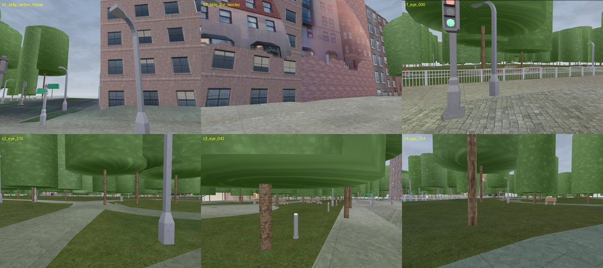

# opencity-forge

opencity-forge turns free map data into a photo-textured 3D model of a city block that you can walk through in a browser.



*Boston Public Garden. Street imagery © Mapillary contributors (CC BY-SA), map data © OpenStreetMap contributors (ODbL), aerial imagery USDA NAIP, elevation USGS 3DEP.*

## Quick start

```sh
python3.11 -m venv .venv && .venv/bin/pip install -r requirements.txt
export OPENCITY_TOKEN_FILE=$HOME/.mapillary_token OPENCITY_USER_AGENT="my-project/1.0 (+https://example.org/contact)"
./opencity new-area my_block --bbox=W,S,E,N     # or use an example: tucson_jacome
./opencity fetch my_block && ./opencity build my_block
./opencity check my_block && ./opencity publish my_block
```

The token file holds a free Mapillary API token on one line. A build also needs Linux, Docker and `gltf-transform` from npm (see Requirements below).

## Data sources

Mapillary 360 photos (CC BY-SA 4.0), OpenStreetMap (ODbL 1.0), USGS 3DEP lidar and USDA NAIP aerial photos (public domain), and CC0 material tiles and models.

## Licence

The code is MIT (see `LICENSE`). A model you build is a derivative of its sources: credit Mapillary and OpenStreetMap, and license it CC BY-SA. The MIT licence covers the code only.

## More

<details><summary>What each command runs</summary>

| Command | What it runs |
|---|---|
| `new-area` | writes `areas/<name>/area.yaml`: box, UTM CRS, time zone, sources picked by location |
| `fetch` | `fetch/fetch_cc0.py` (CC0 material tiles, once), `pipeline/fetch_panos.py` (Mapillary), `fetch/fetch_context.py` (lidar and OSM), `pipeline/fetch_ortho.py` (NAIP aerial photo) |
| `build` | `fetch/fuse_context.py` and `pipeline/nomesh.py` (one frame, panorama poses), `pipeline/derive_knobs.py`, then the stage chain in `pipeline/area_cli.py` (`POSES_STAGES`) |
| `derive` | `pipeline/derive_knobs.py` alone: writes `derived.yaml` (report only for `derive: false` areas) |
| `check` | `model.glb` and `model_web.glb` exist; the model covers the box, has geometry and passes `gltf-transform validate`; the fuse_context selfcheck passes; `derived.yaml` exists |
| `publish` | copies the model to `OPENCITY_PUBLISH` with an `ATTRIBUTION.txt` |
| `areas` | lists the configured areas with box size and title |
| `stage` | runs one stage script for an area, with the repo mounted read-only |

- `fetch` and `build` resume where they stopped. With `--detach` they write a pid file and a `.done` or `.failed` marker under the area's `run/` dir.
- `build --from sNN_name.py` restarts the stage chain at that stage.
- The geometry comes from lidar and OSM footprints. The panoramas, posed by Mapillary and the lidar ground, paint it. No photo mesh is built.
</details>

<details><summary>Requirements: Docker images and external tools</summary>

- Linux, Python 3.11, Docker, and Node.js for `gltf-transform`.
- A Mapillary API token (free) in the file `OPENCITY_TOKEN_FILE` points to.

| Tool | Image or install | Used for | Licence |
|---|---|---|---|
| 3dfier v1.5.0 | `tudelft3d/3dfier:v1.5.0@sha256:95a8e1defe7d8f2e105758bc5ed96e7964f97bda6fb07e577c8ff67cf9dd8264` | OSM footprints plus lidar to ground and building geometry | GPL-3.0, run as a separate program |
| PDAL 2.9.0 | `pdal/pdal:2.9.0@sha256:eb636adfd471721339d1f7793bd5dd78e267fed505c50c7d58b193817817f975` | lidar crop and reprojection | BSD |
| gltf-transform 4.5.0 | `npm install --prefix $OPENCITY_BUILD/gltf @gltf-transform/cli@4.5.0` | glTF resize and validate | MIT |

Images are referenced by digest, so Docker runs only the exact pinned bytes.
</details>

<details><summary>Data sources and licences in full</summary>

A built model is a derivative of its sources. The share-alike terms of the photos and of OSM decide how you may license the model.

| Source | Licence | What a published model must do |
|---|---|---|
| Mapillary 360 photos | CC BY-SA 4.0 | Credit every creator (listed in the model's `manifest.json`). License the model CC BY-SA too. |
| OpenStreetMap | ODbL 1.0 | Credit "(c) OpenStreetMap contributors". The model is a Produced Work. |
| USGS 3DEP lidar | Public domain | None. Credit USGS as good practice. |
| NAIP aerial photo (USDA, via the USGS National Map) | Public domain | None. Credit "USDA NAIP" as a courtesy. The default ortho. |
| ambientCG and Poly Haven material tiles (fetched by `fetch/fetch_cc0.py`) | CC0 1.0 | None. |
| Prop and object kits in `assets/` (Kenney, one Poly Haven model, and models built from trimesh primitives) | CC0 1.0 | None. Sources and URLs are in each `sources.json`. |
| A local ortho you add yourself (a city or county aerial) | Its own terms | Mark it `restricted: true` in `area.yaml` when its terms forbid sale or redistribution. |

- Set `license: public` in `area.yaml` for any build you plan to share. The example areas already do.
- A public build uses NAIP. `opencity publish` refuses a public tag when a source marked `restricted: true` fed the build.
- A local ortho is declared by hand in `sources.ortho` (`primary`, `licence`, `restricted`), with its GeoTIFF tiles and a `source.json` in the area's `ortho/` dir. Its credit goes into the glb metadata.
- City inventories are optional local sources: street trees in `pipeline/city_trees.py` (registry `CITIES`), and street furniture in `pipeline/city_props.py`, whose `CITIES` registry ships empty. Add an entry there to use one. Outside an inventory's envelope the stage writes an empty file and the national fallback runs.
</details>

<details><summary>Paths: where data goes</summary>

Every path comes from one file, `lib/opencity_paths.py`. Each root reads an `OPENCITY_*` environment variable. The defaults are `data/` and `work/` inside the repo, which git ignores.

| Variable | What lives there | Default |
|---|---|---|
| `OPENCITY_DATA` | fetched inputs (`_source/`) and shared scratch | `<repo>/data` |
| `OPENCITY_WORK` | bulky build data: `areas/<name>/` | `<repo>/work` |
| `OPENCITY_PUBLISH` | where `publish` copies a model | `OPENCITY_DATA` |
| `OPENCITY_BUILD` | tool installs: `gltf/` | `OPENCITY_WORK/build` |
| `OPENCITY_VENV` | the Python venv | `<repo>/.venv` |
| `OPENCITY_TOKEN_FILE` | the Mapillary token file (its path only) | `~/.mapillary_token` |
| `OPENCITY_USER_AGENT` | HTTP User-Agent of every download | `opencity-forge/1.0 (python-requests)` |

- `python3 lib/opencity_paths.py --sh` prints every resolved root.
- The Overpass and Nominatim usage policies ask you to name yourself in the User-Agent.
</details>

<details><summary>Example areas</summary>

- `areas/tucson_jacome`: Jacome Plaza, Tucson. Dry, about 200 x 200 m. The smallest example build.
- `areas/boston_public_garden`: the west half of Boston Public Garden (the image above).

Both use public sources only. `derive: true` makes `build` write `derived.yaml`, the knobs measured from the area's own data, into the area's scratch dir (`paths.scratch_dir`).
</details>

## Repo layout

The CLI is `./opencity`. Stage scripts are in `stages/`, the code they share is in `lib/`, and `pipeline/` chains them.

<details><summary>What each folder holds</summary>

| Folder | What it holds |
|---|---|
| `stages/` | the stage scripts `sNN_*.py`, run in the order `pipeline/area_cli.py` lists |
| `lib/` | shared modules (`common.py`, `texlib.py`, `opencity_paths.py`, ...) and three helper packages: `wallphoto/` (facade textures), `objects/` (street objects), `align/` (panorama masks) |
| `pipeline/` | the CLI (`cli.py`, `area_cli.py`), area config, derived knobs, frame, poses and DSM (`nomesh.py`), the panorama and ortho fetchers |
| `fetch/` | the Mapillary, lidar, OSM, CC0 material and fusion tools |
| `areas/` | example area configs |
| `assets/` | CC0 prop and object kits |
| `docs/` | how it works, and the README image |
| `tests/` | the test suite |
</details>

## How it works

See `docs/HOW_IT_WORKS.md` for the stages, the rules they follow and the gates.

<details><summary>Tests</summary>

```sh
.venv/bin/python -m pytest tests -q
```

- The tests need no build data and no network.
- `tests/test_paths.py` fails on a new absolute host path in the code.
- `tests/test_public_gate.py` runs `tools/check_public.py`, which fails on personal or private content in any file.
- Enable the same gate before every push: `git config core.hooksPath .githooks`.
</details>
